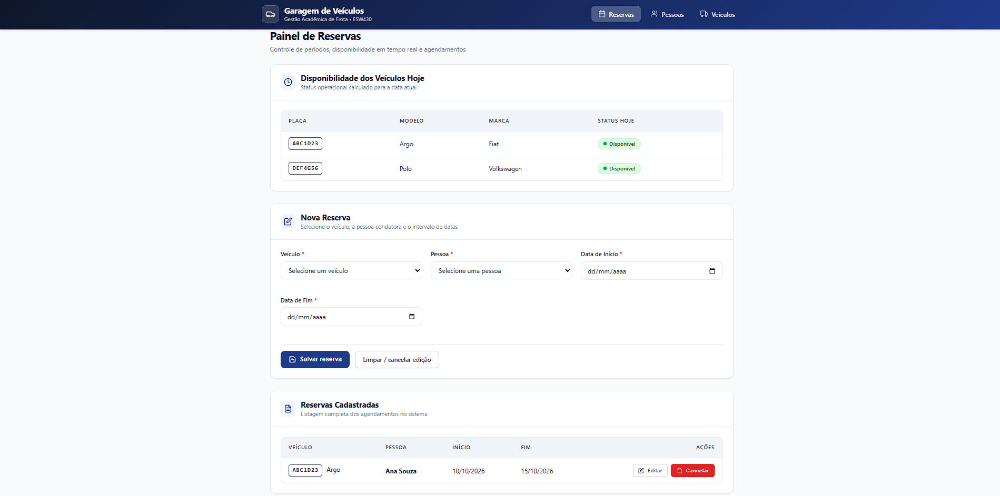
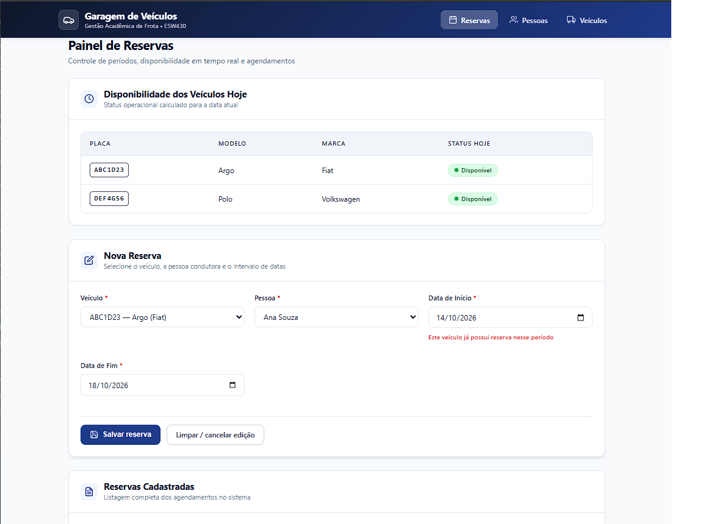

# Vehicle Garage

**Authors:** João Henrique, Gustavo Lopes, João Victor

System built for the **Software Architecture — ESW430 — UniRV** course.

## Tech stack and how to run

Java 17+, Maven 3.8+, Spring Boot 3.3.4, Thymeleaf and Jackson.
In the folder that contains `pom.xml`:

```sh
mvn test
mvn spring-boot:run
```

Open http://localhost:8080. The home page is **Reservas** (Bookings).
Stop it with Ctrl+C and run it again to check persistence.
Data files are stored in `data/`, relative to the folder the app runs from. Always run it from the project root.

## Deliverables

- People: list, create, edit and delete; unique CPF (Brazilian ID number).
- Vehicles: CRUD with unique license plate, make, model, year and optional color.
- Bookings: create by choosing a person and a vehicle, edit the period and cancel.
- Each vehicle's availability is calculated for today's date.
- Start and end dates are inclusive. A booking from 10/10 to 15/10 blocks another one starting on 15/10.
- Reversed dates, missing references and conflicts return errors on the form.
- Sample JSON with two people, two vehicles and one booking.

## Architecture and SOLID

View → Controller → repository interface → JSON repository.
For Bookings, the Controller also uses ReservaService to validate the period and the links.

| Principle | How it is applied |
| --- | --- |
| S | Models hold data and validations; repositories persist; the service validates bookings; controllers coordinate the pages. |
| O | A database implementation can replace the JSON repository without changing controllers and views. |
| L | Controllers depend on the contracts; tests replace repositories with mocks. |
| I | Each entity has its own repository interface. |
| D | Interfaces and the service are received through the constructor; Spring provides the dependencies. |

Each entity has a Model, Interface, Repository, Controller and Views.
Booking uses the form on its own page, `reserva/index.html`.
Overlap is checked by `IReservaRepository.existeConflito`, ignoring the Id of the booking being edited.
ReservaService validates, runs the check and saves only when there are no errors.
The ObjectMapper injected by Spring supports LocalDate; dates are stored as `yyyy-MM-dd` in the JSON.

## Tests and evidence

Run `mvn test` to test conflict boundaries, editing, missing references,
CRUD and persistence through a new repository instance, validations and page rendering.

**Validation status of this update:** 
The application was run locally with Java 17 and Maven.
The first test run had 11 passing tests,
with no failures, errors or skipped tests.
The interface was updated with the help of Antigravity.

See [docs/VALIDACAO.md](docs/VALIDACAO.md) (in Portuguese) for the manual test script and the required screenshots.
The screenshots are in the Delivery 2 Evidence section.

## AI tools used

- Claude (Anthropic): generation and review of the first delivery.
- ChatGPT / Codex (OpenAI): implementation and review of Vehicles and Bookings, and test preparation.
- Antigravity: visual improvements to the Thymeleaf pages and the CSS.

## Limitations

Deleting a person or vehicle that has bookings is not blocked (optional challenge).
Old bookings remain listed with a note that the record was deleted.
The application uses local files and is meant for academic use on a single instance.

## Delivery 2 Evidence




